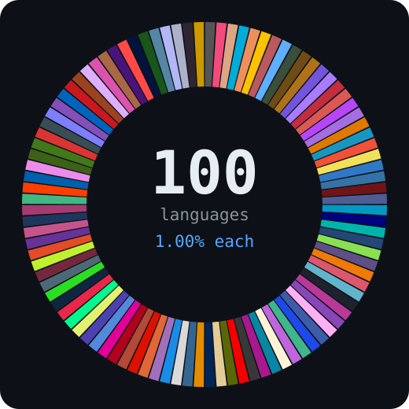

<div align="center">

# polyglot-100

**One hundred programming languages. Exactly one percent each.**

A byte-balanced polyglot archive: every language gets a real program, every
program is padded to an identical byte count, and GitHub's language bar comes
out perfectly flat.

[](docs/LANGUAGES.md)
[](docs/HOW-IT-WORKS.md)
[](MANIFEST.json)
[](docs/HOW-IT-WORKS.md)
[](https://github.com/hackerlemonaru/polyglot-100/actions/workflows/verify.yml)
[](LICENSE)


</div>

---

## The idea

GitHub does not count files, lines, or commits when it draws that coloured bar.
It counts **bytes per language**, using [Linguist][linguist]. So the recipe for a
perfectly flat bar is arithmetic, not magic:

```
100 languages  x  4,096 bytes  =  409,600 counted bytes
4,096 / 409,600  =  0.01  =  1.00% each
```

Every exhibit in `langs/` is exactly 4,096 bytes long. Everything that is not an
exhibit — this README, the docs, the CI config, the generator — is excluded from
the statistics, so nothing can tip the balance.

## The checksum: 55

Every program does the same three things:

1. print a greeting naming its language;
2. compute `sum(1..10)`;
3. compute `fib(10)`.

```
sum(1..10) = 1 + 2 + ... + 10 = 55
fib(10)    = 0,1,1,2,3,5,8,13,21,34,55 -> 55
```

The two answers coincide, which makes **55** a one-number smoke test for the
whole archive. Where a language describes data, markup or silicon rather than
executing instructions, the entry encodes the same payload instead of printing it.

## The hundred

| Family | Languages | Share of the bar |
| --- | --- | ---: |
| **Systems & Native** | C, C++, Rust, Go, Zig, Nim, D, Odin, Cuda, Assembly | 10.00% |
| **Application & Managed** | Java, C#, Kotlin, Scala, Clojure, F#, Vala, Haxe, Apex, Swift | 10.00% |
| **Web & Scripting** | JavaScript, TypeScript, Python, Ruby, PHP, Perl, Lua, Dart, CoffeeScript, Shell | 10.00% |
| **Functional** | Haskell, OCaml, Standard ML, Elm, PureScript, Erlang, Elixir, Gleam, Racket, Scheme | 10.00% |
| **Lisp & Dynamic** | Common Lisp, Emacs Lisp, Fennel, Janet, Io, Wren, Red, Smalltalk, Tcl, PowerShell | 10.00% |
| **Data & Scientific** | SQL, PLpgSQL, PLSQL, R, Julia, MATLAB, Wolfram Language, SAS, Stan, GraphQL | 10.00% |
| **Enterprise & Legacy** | COBOL, Fortran, Pascal, Ada, ABAP, Modula-2, RPGLE, Eiffel, Prolog, Batchfile | 10.00% |
| **Markup & Style** | HTML, CSS, SCSS, Less, Sass, Vue, Svelte, XML, XSLT, TeX | 10.00% |
| **Infra & Config** | Makefile, CMake, Dockerfile, Nix, HCL, Jsonnet, YAML, TOML, Dhall, Protocol Buffer | 10.00% |
| **Frontier & Esoteric** | Solidity, Move, Cairo, WebAssembly, LLVM, GLSL, Verilog, VHDL, Brainfuck, LOLCODE | 10.00% |

Full index with designers, dates and links to every file:
**[docs/LANGUAGES.md](docs/LANGUAGES.md)**.

<div align="center">



</div>

## Verify it

```bash
# offline: byte counts, pinning, manifest agreement
python3 tools/verify.py

# online: ask GitHub what Linguist actually computed
GITHUB_TOKEN=$(gh auth token) python3 tools/verify.py --remote hackerlemonaru/polyglot-100

# run every entry whose toolchain you happen to have installed
bash tools/smoke.sh
```

`tools/verify.py --remote` fails if any language is missing from the bar, if an
unexpected one appears, or if any share drifts more than 0.005 from 1.00%.

## Rebuild it from nothing

```bash
python3 tools/build.py --target-bytes 4096   # materialise langs/ and .gitattributes
python3 tools/render_docs.py                   # README + docs/LANGUAGES.md
python3 tools/render_assets.py                 # the two SVGs above
python3 tools/verify.py                        # prove the invariant
```

Change `--target-bytes` and the whole archive rescales while staying perfectly
flat. The generator refuses to write anything if a program would overflow the
budget, so the invariant cannot be broken silently.

## Layout

```
langs/            100 exhibits, 4,096 bytes each, one language per directory
tools/            generator, verifier, doc renderer, asset renderer, smoke test
docs/             the full index, the Linguist mechanics, GitHub's real limits
assets/           generated SVGs, plus reproducible ballast (see below)
MANIFEST.json     machine-readable index of all 100 entries
.gitattributes    the pinning that makes the 1% split exact
```

## How the pinning works

`.gitattributes` does two jobs. It pins every exhibit, so ambiguous extensions
cannot be misfiled by heuristics — `.m` alone could be Objective-C, MATLAB or
Wolfram Language, and `.v` could be V, Verilog or Coq:

```gitattributes
langs/056-matlab/polyglot.matlab linguist-language=MATLAB linguist-detectable
langs/097-verilog/polyglot.v     linguist-language=Verilog linguist-detectable
```

And it removes the scaffolding from the count entirely:

```gitattributes
README.md   -linguist-detectable
docs/**     -linguist-detectable
tools/**    -linguist-detectable
```

Without that second half, this README alone would add a Markdown slice and the
bar would no longer be flat.

### It did not work on the first try

The first push reported **96 languages, not 100**, while every offline check
passed. Four separate causes, all silent:

| Cause | Effect |
| --- | --- |
| A space in `linguist-language=Standard ML` | git truncates the value to `Standard`; an unknown name makes the file count **zero** bytes |
| `group: Fortran` in the registry | `Fortran Free Form` is always reported as `Fortran` |
| `.mod` claimed by five languages | dropped even with an explicit pin, `detectable`, and `generated=false` |
| `type: data` | SQL, YAML, TOML, XML, GraphQL and Protocol Buffer are not detectable by default |

The full write-up, with the `git check-attr` output and the fixes, is in
**[docs/HOW-IT-WORKS.md](docs/HOW-IT-WORKS.md)**. `tools/verify.py` now resolves
every pin through git itself, so this class of bug fails before a push rather
than after it.

## About the size of this repository

This repo deliberately carries a large, reproducible binary ballast under
`assets/ballast/`, which pushes the checkout close to GitHub's recommended
ceiling. It is honest padding: it is generated from a fixed seed, it is
checksummed, it is excluded from the language statistics, and it contributes
nothing to the exhibits.

If you only want the code, do not download it:

```bash
git clone --filter=blob:none --sparse https://github.com/hackerlemonaru/polyglot-100.git
cd polyglot-100
git sparse-checkout set langs tools docs
```

GitHub's actual limits, and why "as big as possible" is not a great target, are
written up in **[docs/LIMITS.md](docs/LIMITS.md)**.

## Honest caveat

This is a demonstration of how GitHub measures languages, not a claim that
anyone wrote production systems in a hundred languages. The programs are real
and the arithmetic is real; the flat bar is a consequence of the byte budget,
by design. Treat it as a curiosity and a Linguist reference, not a résumé.

## Licence

MIT. See [LICENSE](LICENSE).

[linguist]: https://github.com/github-linguist/linguist
